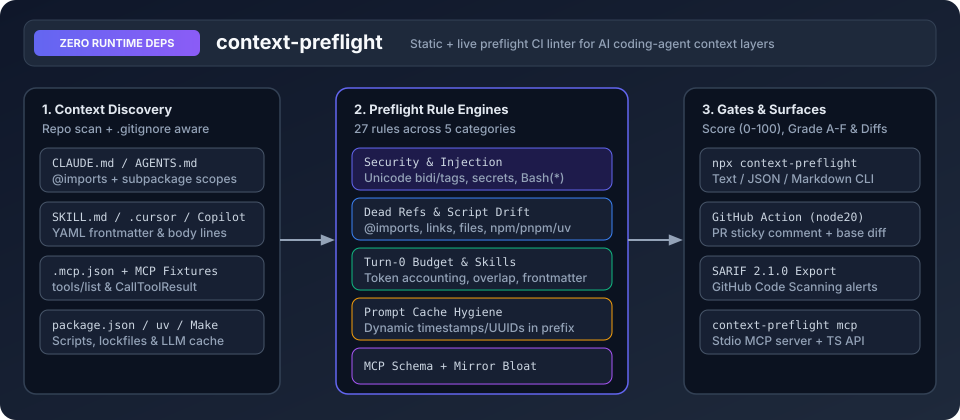

# context-preflight

**Zero-runtime-dependency preflight CI linter, GitHub Action, SARIF analyzer, and MCP server for AI coding-agent context layers.**

`context-preflight` audits `CLAUDE.md`, `AGENTS.md`, `GEMINI.md`, `.github/copilot-instructions.md`, `.cursor/rules/*`, `SKILL.md`, `.claude/settings.json`, `.mcp.json`, saved MCP tool schemas/payloads, and LLM prompt-cache call sites before silent drift, token bloat, broken references, or hidden prompt injections ship to `main`.



## Why Context Needs CI Preflight

Teams carefully CI-test source code, yet leave the instruction files and MCP configs loaded on every coding-agent turn unvalidated:

- **Silent context rot**: A file gets renamed, a `package.json` script is removed, or `CLAUDE.md` imports a deleted path (`@docs/old.md`). Agents waste turns hunting for missing files or running broken commands.
- **Turn-0 token tax**: Root `CLAUDE.md`, `AGENTS.md`, `GEMINI.md`, `.cursorrules`, `@import` trees, and MCP schemas load before the user types a single word. Passing your turn-0 budget degrades recall and burns quota.
- **Security & supply-chain hazards**: Invisible Unicode bidi overrides / tag characters, hardcoded API keys in `.mcp.json`, overly broad `Bash(*)` permissions in `.claude/settings.json`, or unpinned `npx -y` servers silently bypass review.
- **Prompt cache invalidation & MCP bloat**: Dynamic `Date.now()` / `uuid4()` calls inside cached system prompt prefixes invalidate KV caches every turn, while verbose MCP schemas or mirrored `text` + `structuredContent` responses double payload tokens.

`context-preflight` catches all of these in **milliseconds** using **zero runtime dependencies** (`dependencies: {}`).

---

## Quickstart (10 Seconds)

Run against any repository without installing dependencies:

```bash
npx context-preflight
```

Audit the bundled healthy example or generate a starter workflow:

```bash
npx context-preflight ./examples/healthy
npx context-preflight init
```

Compare a branch against a saved baseline report in PRs:

```bash
npx context-preflight --format json --output .preflight-baseline.json
npx context-preflight compare .preflight-baseline.json . --format markdown
```

---

## GitHub Action

Drop `.github/workflows/context-preflight.yml` into any repository for PR health checks, base-branch token deltas, sticky PR comments, Job Summaries, and optional GitHub Code Scanning SARIF alerts:

```yaml
name: Context Preflight

on:
  pull_request:
  push:
    branches: [main]

permissions:
  contents: read
  pull-requests: write
  security-events: write

jobs:
  preflight:
    runs-on: ubuntu-latest
    steps:
      - uses: actions/checkout@v4
        with:
          fetch-depth: 0

      - uses: SiluPanda/context-preflight@v1
        with:
          fail-on: error
          max-turn0-tokens: "8000"
          comment-pr: "true"
          sarif-file: context-preflight.sarif

      - uses: github/codeql-action/upload-sarif@v3
        if: always()
        with:
          sarif_file: context-preflight.sarif
```

### Action Inputs & Outputs

| Input              | Default               | Description                                                     |
| :----------------- | :-------------------- | :-------------------------------------------------------------- |
| `path`             | `"."`                 | Repository subdirectory to scan                                 |
| `max-turn0-tokens` | `"8000"`              | Maximum estimated turn-0 context tokens before failing          |
| `max-file-tokens`  | `"4000"`              | Maximum estimated tokens per always-loaded instruction file     |
| `max-skill-lines`  | `"500"`               | Maximum recommended lines per `SKILL.md` body                   |
| `fail-on`          | `"error"`             | Exit threshold: `error`, `warning`, or `never`                  |
| `ignore-rules`     | `""`                  | Comma-separated rule IDs to suppress                            |
| `ignore-paths`     | `""`                  | Comma-separated file/directory patterns to ignore               |
| `sarif-file`       | `""`                  | Optional output file path for SARIF 2.1.0 results               |
| `comment-pr`       | `"true"`              | Create or update sticky `<!-- context-preflight -->` PR comment |
| `github-token`     | `${{ github.token }}` | Token used for PR comment updates                               |

Outputs emitted on `steps.<id>.outputs`: `score`, `grade`, `passed`, `turn0-tokens`, `error-count`, `warning-count`, `sarif-file`.

---

## Built-in Rule Reference (27 Rules)

### Security & Configuration (`security`)

| Rule ID                    | Severity            | Description                                                                                                   |
| :------------------------- | :------------------ | :------------------------------------------------------------------------------------------------------------ |
| `hidden-unicode`           | `error`             | Detects zero-width chars, bidirectional overrides, and Unicode tags in context files                          |
| `plaintext-secret`         | `error`             | Flags hardcoded Anthropic/OpenAI/GitHub/AWS/Slack/GitLab keys while ignoring `${ENV_VAR}` placeholders        |
| `invalid-json-config`      | `error`             | Flags malformed `.mcp.json` or `.claude/settings.json` configs                                                |
| `unsafe-permission-rule`   | `warning`           | Flags overly broad allow rules in `.claude/settings.json` such as `Bash(*)` or `Bash(sudo ...)`               |
| `unsafe-mcp-config`        | `warning`           | Flags unpinned `npx -y <package>` MCP servers without an explicit version pin                                 |
| `prompt-injection-pattern` | `error` / `warning` | Flags hidden instruction overrides, concealment directives, exfil patterns, and unverified remote shell pipes |

### Dead References & Tooling Drift (`references`)

| Rule ID                 | Severity            | Description                                                                                                   |
| :---------------------- | :------------------ | :------------------------------------------------------------------------------------------------------------ |
| `broken-import`         | `error`             | Validates Claude Code `@path/to/file` imports without false-positiving on scoped npm names like `@org/pkg`    |
| `broken-markdown-link`  | `error`             | Checks relative Markdown links against repository files                                                       |
| `broken-mcp-entrypoint` | `error`             | Verifies local script paths referenced in `.mcp.json` `args` exist on disk                                    |
| `broken-file-ref`       | `warning`           | Checks backticked repository file paths while skipping code fences, examples, and third-party SDK paths       |
| `missing-script`        | `error` / `warning` | Validates `npm/pnpm/yarn/bun run <script>` (and fenced `make <target>`) against `package.json` / `Makefile`   |
| `package-manager-drift` | `warning`           | Flags instructions using `npm`/`pip install` in repos governed by `pnpm-lock.yaml`, `yarn.lock`, or `uv.lock` |

### Budgets, Skills & Prompt Caching (`budget`, `skill`)

| Rule ID                         | Severity            | Description                                                                                                       |
| :------------------------------ | :------------------ | :---------------------------------------------------------------------------------------------------------------- |
| `skill-frontmatter-invalid`     | `error` / `warning` | Ensures `SKILL.md` contains valid YAML frontmatter with required `name` and `description`                         |
| `skill-bloat`                   | `warning`           | Flags `SKILL.md` files exceeding `--max-skill-lines` (default `500`)                                              |
| `instruction-file-bloat`        | `warning`           | Flags single always-loaded context files exceeding `--max-file-tokens` (default `4000`)                           |
| `turn0-budget-warning`          | `warning`           | Warns when always-loaded turn-0 context crosses 75% of `--max-turn0-tokens`                                       |
| `turn0-budget-exceeded`         | `error`             | Fails when always-loaded turn-0 context (including deduplicated `@import` trees) exceeds `--max-turn0-tokens`     |
| `duplicate-instruction-overlap` | `info`              | Detects >60% 4-gram overlap between root `CLAUDE.md` and `AGENTS.md` (suggests `@CLAUDE.md`)                      |
| `cache-breaker-risk`            | `warning`           | Flags volatile `Date.now()` / `new Date()` / `time.time()` / `uuid4()` calls inside cached system prompt prefixes |

### MCP Schemas & Payload Waste (`mcp`)

| Rule ID                       | Severity            | Description                                                                                                         |
| :---------------------------- | :------------------ | :------------------------------------------------------------------------------------------------------------------ |
| `duplicate-tool-name`         | `error`             | Flags duplicate tool names in an MCP server `tools/list` response                                                   |
| `invalid-tool-schema`         | `error` / `warning` | Validates `inputSchema` object roots, missing `properties` entries referenced by `required`, and empty descriptions |
| `mcp-payload-budget-exceeded` | `error`             | Flags MCP result payloads exceeding `--max-mcp-bytes` (default `65536`)                                             |
| `missing-tool-description`    | `warning`           | Flags MCP tools missing LLM-facing descriptions                                                                     |
| `oversized-tool-schema`       | `warning`           | Flags MCP tools exceeding `--max-tool-desc-tokens` (default `300`)                                                  |
| `mcp-probe-failed`            | `warning`           | Reports spawn/timeout errors when `--probe-mcp` inspects local stdio servers                                        |
| `mirror-payload-bloat`        | `info`              | Detects `text` content blocks verbatim-mirroring `structuredContent`                                                |
| `repeated-payload-subtrees`   | `info`              | Detects repeated JSON subtrees >= 64 bytes inside MCP tool result payloads                                          |

---

## Real-World Audit Results

Validated locally against real open-source repositories across Python, Rust, TypeScript, and C++:

| Repository          |         Artifacts Scanned |            Turn-0 Context | Findings Summary                                                             |
| :------------------ | ------------------------: | ------------------------: | :--------------------------------------------------------------------------- |
| `chroma`            |                   3 files |          ~571 tokens (7%) | `100/100 (A)` — 0 errors, 0 warnings                                         |
| `vllm`              | 17 files (incl. 9 skills) |       ~2,338 tokens (29%) | `100/100 (A)` — 0 errors, 0 warnings                                         |
| `aibrix`            |                    1 file | ~0 root / 1,279 on-demand | `100/100 (A)` — 0 errors, 0 warnings                                         |
| `onnxruntime-genai` |                   2 files |       ~1,605 tokens (20%) | `93/100 (A)` — flagged missing `expansions/standard.py` ref                  |
| `litellm`           |                  27 files |       ~4,157 tokens (52%) | `58/100 (F)` — flagged 4,028-tok `CLAUDE.md`, stale refs, `uv.lock` vs `pip` |
| `dynamo`            |                  42 files |       ~4,480 tokens (56%) | `65/100 (D)` — flagged 4,480-tok `AGENTS.md` and stale file paths            |
| `mcp-payload-audit` |            2 MCP fixtures |                 ~0 tokens | `97/100 (A)` — flagged mirrored `structuredContent` & repeated subtrees      |

---

## CLI Reference

```text
Usage:
  context-preflight [scan] [path] [options]
  context-preflight compare <baseline.json> [path] [options]
  context-preflight init [path]
  context-preflight mcp
```

Options:

- `--format <text|json|markdown|sarif>` — Output format (`text` by default)
- `--output <file>` — Write report output to a file
- `--baseline <file.json>` — Diff against a baseline `PreflightReport` JSON file
- `--max-turn0-tokens <n>` — Turn-0 token budget (default `8000`)
- `--max-file-tokens <n>` — Single always-loaded file limit (default `4000`)
- `--max-skill-lines <n>` — `SKILL.md` line threshold (default `500`)
- `--max-mcp-bytes <n>` — MCP payload byte budget (default `65536`)
- `--max-tool-desc-tokens <n>` — Per-tool description token budget (default `300`)
- `--fail-on <error|warning|never>` — Non-zero exit condition (default `error`)
- `--ignore-rule <ruleId>` — Suppress a specific rule (repeatable)
- `--ignore-path <glob>` — Skip matching paths/directories (repeatable)
- `--probe-mcp` — Opt-in live stdio MCP `initialize` + `tools/list` schema probing from `.mcp.json`
- `--probe-timeout <ms>` — Per-server live probe timeout (default `5000`)
- `--no-code-prompts` — Skip scanning TS/JS/Python files for prompt-cache invalidators
- `--no-color` — Disable ANSI color codes

Exit codes: `0` (pass), `1` (failed threshold), `2` (invalid arguments or unreadable target).

---

## MCP Server Mode

`context-preflight` doubles as a lightweight stdio Model Context Protocol server (`2025-11-25`) exposing:

- `preflight_scan` (`rootDir`, `maxTurn0Tokens`)
- `preflight_compare` (`baselinePath`, `rootDir`)

Add it to `.mcp.json` or any MCP client:

```json
{
  "mcpServers": {
    "context-preflight": {
      "command": "npx",
      "args": ["-y", "context-preflight@0.1.0", "mcp"]
    }
  }
}
```

---

## Programmatic TypeScript / Node.js API

Full ESM, CJS, and `.d.ts` exports verified with `publint` and `@arethetypeswrong/cli`:

```ts
import {
  analyzeRepository,
  diffReports,
  formatMarkdownReport,
  formatSarifReport,
} from "context-preflight";

const report = await analyzeRepository({
  rootDir: process.cwd(),
  maxTurn0Tokens: 8000,
  failOn: "error",
});

console.log(report.summary.score, report.summary.grade);
console.log(formatMarkdownReport(report));
```

---

## License

[MIT](LICENSE)
